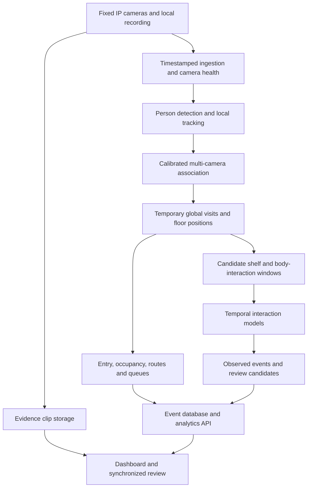

# Sentient: retail video analytics research and implementation plan

Research date: 29 October 2026. Input: `plan.txt` and the clarification that camera coordination and a consistent shopper ID matter, while receipts/POS integration are outside scope.

This is the initial research and engineering proposal. A subsequent local training pilot is documented separately in [TRAINING_RESULT.md](TRAINING_RESULT.md). Accuracy, capacity, annotation quantities, and timelines below remain proposed targets or planning estimates, not that pilot's measured results. Store layout, camera count, budget, and deployment country remain unspecified.

## Recommendation

Build a camera-based retail analytics system in stages, using pretrained detection and tracking components. Do not train a foundation model from scratch.

The first technical milestone should be **one shopper journey across two overlapping, calibrated cameras**, including people passing each other and disappearing behind shelves. Build entry counts, queues, and zone analytics on that foundation. Then train or fine-tune a separate model for shelf interactions. Add security review alerts only after the event and identity associations work reliably.

There is no single production-validated, unrestricted open-source model identified in this research that implements the whole plan. There are usable components for most of it, and relevant public datasets for the harder parts. The main challenges are camera coverage, cross-camera association, store-specific data, and false alerts.

Two implementation paths deserve an early comparison:

1. **Fastest route if NVIDIA hardware is acceptable:** evaluate NVIDIA DeepStream's multi-view 3D tracking (MV3DT) reference application and camera-calibration tooling on a small real camera network. Its reference architecture already addresses the shared-ID problem. Published source components use Apache-2.0, but runtime binaries and downloaded model assets have separate terms; this is a mixed stack rather than a blanket claim of unrestricted open source. [DeepStream repository](https://github.com/NVIDIA/DeepStream), [MV3DT reference application](https://github.com/NVIDIA/DeepStream/blob/main/src/apps/reference_apps/deepstream-tracker-3d-multi-view/README.md).
2. **Most control over the application:** RF-DETR or original RT-DETRv2, a ByteTrack/BoT-SORT implementation, and a global association service using calibrated geometry, timestamps, and optionally body-appearance embeddings. Intel SceneScape is an Apache-2.0 reference architecture worth testing before writing that service entirely ourselves. [SceneScape](https://github.com/open-edge-platform/scenescape).

My preference is to time-box the existing multi-camera stack evaluation first, with a simple modular detector/tracker baseline for comparison. Select the implementation from footage and deployment constraints, not from a generic model leaderboard.

## What the requested features actually require

| Feature in the plan | Practical implementation | Initial feasibility and limits |
|---|---|---|
| Entry/exit counts and busiest hours | Person detection, tracking, directional doorway crossing events, time aggregation | Strong first deliverable with a suitable entrance view. Measures visits/crossings; does not identify unique people across weeks. |
| Weekly/monthly summaries | Queries over timestamped events, with camera uptime and coverage recorded | Straightforward once event quality is established. Missing footage must appear as missing coverage. |
| Occupancy by store area | Calibrated positions assigned to floor-plan polygons | Strong with visible floor areas; overlap must be deduplicated. |
| Popular-zone heatmaps | Separate visit counts and accumulated person-seconds per area | Feasible. High foot traffic or long dwell does not establish purchases. |
| Popular routes | Ordered zone transitions linked by a temporary global visit ID | Depends on cross-camera continuity. Unobserved segments must remain unknown. |
| Queue length and waiting time | Queue, service, and exit zones; per-visit state transitions | Good with an appropriate view. Queue occupancy alone is not a wait-time measurement. |
| Shelf identification | Manually mapped shelf/bay polygons linked to the floor plan | Easy for fixed layouts. Automatic shelf discovery is optional. |
| Product/SKU recognition | Close product views, a product catalog, and store-specific training/reference images | Separate problem from identifying a shelf. Overhead footage may not resolve packaging details. |
| Picking an item / returning it | Temporal human-object interaction model, ideally two views | Relevant datasets exist, but store adaptation and event labels are needed. |
| Concealment and suspicious exit | Combine observed interaction events, body/item motion, journey continuity, and exit events | Suitable for review candidates; payment status remains unknown. |
| Stealing from another shopper | Separate person-person-object interaction task | Do not assume a shelf-pickup or concealment model covers pickpocketing/snatching. |

With the agreed camera-only scope, the product can report **an observed action and its supporting video**, including whether the associated shopper visited a checkout area. It cannot reliably establish that a particular item was paid for. A checkout visit, visible scanning gesture, or absence from the checkout view is only visual evidence with limitations.

This also changes the commercial analytics vocabulary: report traffic, dwell, interactions, and observed checkout visits. Revenue, confirmed sales conversion, and which shelves generated actual purchases require another source of truth and are outside this version.

## Existing models and software

The distinctions here matter: a detector finds people or products; a tracker connects detections; an action model interprets a sequence; application logic turns observations into metrics.

| Component | Available starting point | Role and selection notes |
|---|---|---|
| Multi-camera tracking | DeepStream MV3DT + AutoMagicCalib | Existing reference implementation for calibrated camera networks and shared IDs. Evaluate occlusions, coverage gaps, runtime requirements, and asset terms locally. |
| Spatial fusion alternative | Intel SceneScape | Reference architecture for bringing sensor observations into a common coordinate frame. Needs application-specific analytics and validation. |
| Person/object detection | RF-DETR Nano or Small | Pretrained detector and fine-tuning path. These particular detection sizes have Apache-2.0 code/weights. Benchmark both on actual overhead footage. |
| Detector alternative | Original RT-DETRv2 | Official repository includes training/inference code and weights under Apache-2.0. Use the original implementation rather than assuming a third-party wrapper has the same license. |
| Per-camera tracking | ByteTrack; BoT-SORT | No bespoke tracker training needed to start. The Apache-2.0 `trackers` package provides detector-independent implementations. These do not by themselves solve whole-store identity. |
| Body-appearance matching | OSNet through Torchreid | Existing re-identification architecture and downloadable pretrained models. MIT code; separately check the selected checkpoint and its training-data terms. Useful as one association signal, not a guaranteed identity service. |
| Zones and annotations | Supervision | MIT utilities for lines, polygons, detections, and visualization. Its built-in ByteTrack wrapper is being superseded by the external `trackers` package. |
| Body pose | RTMPose through MMPose | Optional wrist/body keypoints for interaction proposals and action features. Code is Apache-2.0; choose and record the exact checkpoint and training provenance. |
| Temporal actions | MMAction2 models, or a small custom temporal head | Existing action-recognition/localization implementations can be adapted. Generic pretrained action categories do not equal a ready-made retail model. |
| Label assistance | Grounding DINO and SAM 2 | Useful for proposing boxes/masks and propagating labels. Human correction is still necessary. |
| Clip description | Qwen3-VL-4B-Instruct | Optional second-pass descriptions for reviewers. Apache-2.0 model card; not the authority for counts, identity, or payment conclusions. |
| Recording and playback | Existing NVR, or Frigate | Reuse recording, retention, and playback rather than building an NVR from scratch. Frigate's code is MIT; the retail analytics layer remains our work. |

Sources: [RF-DETR repository](https://github.com/roboflow/rf-detr), [RF-DETR size-specific licensing](https://roboflow.com/model-licenses/rf-detr), [original RT-DETR](https://github.com/lyuwenyu/RT-DETR), [trackers](https://github.com/roboflow/trackers), [Supervision FAQ](https://supervision.roboflow.com/develop/faq/), [MMPose](https://github.com/open-mmlab/mmpose), [MMAction2](https://github.com/open-mmlab/mmaction2), [Grounding DINO](https://github.com/IDEA-Research/GroundingDINO), [SAM 2](https://github.com/facebookresearch/sam2), [Qwen model card](https://huggingface.co/Qwen/Qwen3-VL-4B-Instruct), [Frigate](https://github.com/blakeblackshear/frigate).

For appearance matching, the [Torchreid model zoo](https://kaiyangzhou.github.io/deep-person-reid/MODEL_ZOO) provides OSNet checkpoints, while the [repository license](https://github.com/KaiyangZhou/deep-person-reid/blob/master/LICENSE) covers the software. Benchmark top-down and oblique camera pairs separately; a model trained on pedestrian crops may transfer poorly to overhead views.

Ultralytics YOLO is also technically viable. Its licensing options are AGPL-3.0 and Enterprise; the vendor's stated requirements for proprietary use need accounting for. AGPL is an open-source license, not a general prohibition on commercial activity. The recommendation above avoids making that licensing model a dependency for a proprietary Sentient product. [Ultralytics licensing](https://www.ultralytics.com/license).

**Research model availability needs careful checking.** Shopformer is a relevant pose-based shoplifting anomaly paper, but the public repository tree checked on the research date contains a README, environment file, license, and illustration—not the model/training directories its README describes. No runnable release or pretrained checkpoint was verified. Treat it as a research reference rather than a drop-in dependency. Its reported 69.15 ROC-AUC and 44.49 PR-AUC are benchmark metrics, not an operational theft-detection success rate. [Official Shopformer repository](https://github.com/TeCSAR-UNCC/Shopformer), [paper](https://openaccess.thecvf.com/content/CVPR2025W/ABAW/papers/Rashvand_Shopformer_Transformer-Based_Framework_for_Detecting_Shoplifting_via_Human_Pose_CVPRW_2025_paper.pdf).

## Cameras and shared shopper IDs

Synchronization is necessary for useful multi-view fusion, but synchronization alone does not preserve identity. Four things must work together: coverage, geometry, time, and association.

### A small camera network before a whole store

Start with a doorway view, an overlapping pair covering one shelf and its aisle, and a checkout-area view if that is part of the intended journey. This is an illustrative three-to-four-camera pilot if views can serve more than one role; the actual count comes from the floor plan and visibility survey.

Every critical transition should have observable overlap or a constrained, short transition through a known gap. An overhead camera is helpful for counting, but an oblique complementary view may reveal hands or products hidden from above. Product detail and full-body appearance impose different requirements. A wide fisheye view can cover the floor yet provide too few pixels for small items.

For the first deployment, use fixed cameras and a wired PoE network. Avoid changing PTZ views because movement invalidates fixed geometry and zone mappings. Evaluate full-resolution image crops of the smallest relevant objects under actual lighting and walking speed. A higher megapixel specification alone does not establish useful item visibility.

### Procurement requirements to test

- Accessible RTSP streams and documented timestamp behavior; ONVIF support helps configuration and interoperability.
- Common configurable time source, stable frame cadence, fixed exposure options, adequate shutter speed, and low motion blur.
- Enough resolution at the shelf and entrance, with usable low-light images and manageable compression artifacts.
- Retention of original stream timestamps through recording, decoding, replay, and reconnects.
- Lens and installation information sufficient for calibration; explicit dewarping if using fisheye cameras.

ONVIF Profile T covers video and metadata interoperability, but should not be treated as a guarantee of precise synchronization. Test the exact camera model and firmware. GStreamer's RTSP implementation exposes clock synchronization and reference timestamp facilities; support depends on what the source actually supplies. [ONVIF Profile T](https://www.onvif.org/profiles/profile-t/), [GStreamer rtspsrc](https://gstreamer.freedesktop.org/documentation/rtsp/rtspsrc.html).

### Synchronization and calibration protocol

1. Put cameras and the ingestion server on a common local time source. Preserve capture/reference timestamps separately from network arrival and processing time.
2. Measure relative timing with an event visible in the overlapping views, such as a test light, and repeat over a full operating day and after reconnects. An illustrative engineering target is p95 relative error below 50 ms for the action pair; establish the actual tolerance through replay experiments. This is a proposed target, not a claimed camera standard or a guarantee from NTP.
3. Correct lens distortion, estimate camera geometry, and map observations into one floor coordinate system. Manually verify known reference points and test moving people throughout the scene.
4. Use ground-plane mapping for floor positions. Do not map elevated hands or shelf items with the same floor homography; use separate shelf-plane mappings or a calibrated 3D representation.
5. Monitor drift, freezes, changes in camera pose, and missing coverage. When time or calibration becomes unreliable, suspend the affected cross-camera associations and mark the interval degraded.

Hardware PTP or trigger synchronization is an option if experiments show that ordinary camera timing is insufficient for the chosen fusion method. It should not be imposed on every camera before we know the required precision.

### What identity means in this system

Use a temporary **global visit ID**, not a named identity or a permanent customer identifier. Each camera still has local track IDs. Associate `(camera_id, stream_session_id, local_track_id)` observations with a global visit, recording confidence and association history.

For overlapping views, prioritize compatible world positions, motion, timing, and simultaneous observations. For non-overlapping views, constrain candidates by the camera connectivity graph and travel time, then optionally compare body-appearance embeddings. Appearance alone is unreliable with uniforms, similar clothing, changing orientation, or very small crops.

The system must support unknown links, split tracks, and corrected associations. Never force a match merely to make a route look complete. One incorrect merge can attach one shopper's action to another shopper's exit.

DeepStream's documented MV3DT design uses calibrated projections and shared tracklets to associate observations into global IDs. That is directly relevant to this requirement, but its published architecture does not establish performance on our cameras. [NVIDIA MV3DT explanation](https://developer.nvidia.com/blog/build-a-multi-camera-3d-tracking-application-with-nvidia-deepstream-9-1-skills/).

For live views, publish provisional associations; allow a short bounded smoothing delay and a later, versioned reconstruction for end-of-day routes. Count overlapping views of one person once. Report route coverage and identity uncertainty alongside route popularity.

## Public datasets: useful, but not interchangeable

| Dataset | Useful supervision | Important limitation / rights status |
|---|---|---|
| RetailAction | Real multi-view take/put/touch events, locations and temporal bounds | Best task match found for shelf interactions. Custom license with a commercial revenue condition. |
| PoseLift | Retail pose sequences and anomaly labels from six camera views | Useful for pose-based security research; no raw video for training an RGB hand/item model. Repository has Apache-2.0 license; confirm terms in the downloaded dataset package. |
| RetailS | Large normal-behavior pose corpus plus staged and authentic shoplifting examples | Useful for testing domain drift and false alerts. Dataset is linked externally; commercial rights and a complete runnable model release were not established. |
| MERL Shopping | Reach, retract, hand-in-shelf and inspection action intervals | Small, older, controlled setting; research download. Does not directly label paid/unpaid events. |
| SKU-110K | Dense product bounding boxes | Generic product instances, not a store-specific SKU classifier. Original release explicitly restricts use to academic/non-commercial purposes. |
| RPC | Controlled exemplar and checkout images, fine-grained products | CC BY-NC-SA 4.0; unsuitable as the default commercial training source without additional permission. |
| Products-10K | Product recognition images | Official terms restrict to non-commercial research/education. Different domain from overhead video. |
| Unitail-Det | Dense product localization | Official access restricted to academic inquiries to prevent unauthorized commercial use. |
| MMPTRACK | Calibrated multi-camera person trajectories, including simulated retail | Valuable tracking benchmark; research-only access by agreement. |
| Humans in the Loop supermarket shelves | Product and price-tag boxes | CC0; only 45 images, so a useful small seed/evaluation source rather than a full training solution. |
| MNNIT Shoplifting Dataset | Staged normal/concealment videos | CC BY 4.0. Version 1 lists an archive; version 2 is metadata-only. Lab-to-store transfer needs testing. |
| UCF-Crime | Broad surveillance anomaly categories including shoplifting | A research benchmark, not item ownership/payment ground truth. Do not assume a mirror's permissive tag settles original footage rights. |
| Snatch 1.0 | Snatch-theft surveillance material | Separate exploratory reference for person-person theft; license was not clear in the public page inspected. Not a validated supermarket pickpocketing solution. |

Primary sources: [RetailAction](https://huggingface.co/datasets/standard-cognition/RetailAction), [PoseLift](https://github.com/TeCSAR-UNCC/PoseLift), [RetailS](https://github.com/TeCSAR-UNCC/RetailS), [MERL Shopping](https://merl.com/research/highlights/merl-shopping-dataset), [SKU-110K original release](https://github.com/eg4000/SKU110K_CVPR19), [RPC](https://rpc-dataset.github.io/), [Products-10K terms](https://products-10k.github.io/challenge.html), [Unitail-Det](https://unitedretail.github.io/Unitail-Det/), [MMPTRACK](https://iccv2021-mmp.github.io/subpage/dataset.html), [CC0 shelf dataset](https://humansintheloop.org/resources/datasets/supermarket-shelves-dataset/), [MNNIT version 1](https://data.mendeley.com/datasets/r3yjf35hzr/1), [MNNIT version 2](https://data.mendeley.com/datasets/r3yjf35hzr/2), [UCF-Crime project](https://www.crcv.ucf.edu/projects/real-world/), [Snatch 1.0](https://zenodo.org/records/10812645).

### RetailAction is promising, with two substantial catches

The paper introduces 21,000 dual-view samples from ten real convenience stores, approximately 41 hours of video. It labels interaction points and temporal intervals rather than just saying a whole video contains shopping. That makes it much closer to the intended pickup feature than a generic anomaly dataset. [RetailAction paper](https://openaccess.thecvf.com/content/ICCV2025W/RetailVision/papers/Mazzini_RetailAction_Dataset_for_Multi-View_Spatio-Temporal_Localization_of_Human-Object_Interactions_in_ICCVW_2025_paper.pdf).

The data card reports strong imbalance toward `take` (97.2% of actions), shopper-separated splits, and motion-selected clips with at most 32 frames. Those frames must not be treated as uniformly sampled real-time video. The listed MViT-b baseline reaches 41.7 mAP under the dataset's spatial/temporal protocol; this is neither 41.7% business accuracy nor proof of deployability. The released labels also do not establish item payment or complete virtual baskets. [Official data card](https://huggingface.co/datasets/standard-cognition/RetailAction).

The actual license requires attribution and continued deidentification, and says a separate grant must be requested once revenue from products/services using or incorporating the dataset materials exceeds USD 10,000; exercise of the rights then requires that express grant. Product/model use is explicitly addressed. Do not treat this as unrestricted commercial open data, and do not assume fine-tuning removes the condition. [Actual RetailAction license](https://huggingface.co/datasets/standard-cognition/RetailAction/blob/main/LICENSE).

**Commercial training options:** obtain suitable RetailAction rights, or build the interaction dataset from footage and staged sessions we are authorized to use. Keep research-only experiments and production training lineages separate. Record code, checkpoint, dataset version, and permissions for each trained artifact.

## What to train, and how

### Stage A: establish a pretrained baseline

Initially train nothing. Compare RF-DETR Nano/Small and an original RT-DETRv2 small model on identical clips, first with fixed tracker settings and then with limited tracker tuning. Evaluate the resulting counts and trajectories, not just detection mAP. If using MV3DT, also evaluate its supported detector configuration and model terms.

Use full store conditions: crowded and quiet intervals, strong backlight, delivery staff, baskets, groups, children, people pausing in the doorway, exits followed by immediate returns, and shelf occlusions. Avoid selecting only attractive demo clips.

Fine-tune the person detector only if failure analysis shows systematic missed or incorrect detections. A starting annotation budget is roughly 1,000–3,000 diverse frames, expanded using learning curves. That number is an initial experiment budget, not a minimum that guarantees accuracy. Maintain track/event labels separately from person boxes.

### Stage B: learn observable interactions

Start with one shelf bay and a few representative product types. Use coarse shelf/hand proximity to propose candidate windows, then a temporal classifier/localizer to distinguish `take`, `put_back`, `touch`, `inspect`, `place_in_basket`, and `unknown` where visible.

A practical first trainable model is a pretrained compact video encoder with a small temporal head, using person/shelf crops and optional wrist/body features. Compare RGB-only, pose-only, and combined features. A pose-only system may miss object evidence; an RGB system may learn background shortcuts. Introduce two-view fusion after the single-view baseline is understood.

For a concrete low-cost baseline, extract frozen X3D-S video features and train a small temporal head on local event labels, alongside a temporal-convolution baseline over normalized pose features. MMAction2 lists an X3D-S checkpoint, but its X3D documentation currently describes testing support rather than a complete supported training recipe. A custom feature-head trainer or a different supported backbone is needed; verify that path before scheduling full-backbone fine-tuning. [X3D implementation and checkpoint notes](https://raw.githubusercontent.com/open-mmlab/mmaction2/main/configs/recognition/x3d/README.md).

MMAction2 supplies usable action-model implementations, but adapting a clip classifier into event localization requires additional labeling and code. A simple first implementation can use overlapping temporal windows with event-boundary merging; evaluate timestamp and duration error explicitly.

Plan an initial local collection of roughly 2,000–5,000 interaction/background windows, deliberately covering returns, no-action windows, simultaneous shoppers, and occlusions. Record product transfer visibility and label uncertainty. Expand the set when held-out performance plateaus below target. Returns and rare classes need targeted collection even when overall accuracy looks high.

For all derived public pose data, inspect the actual keypoint schema rather than hard-coding the joint count from prose. Match coordinate conventions, timestamps, confidence handling, and missing-joint treatment between training and deployment.

### Stage C: security review events

Use visible event classes such as `possible_concealment` or `possible_person_to_person_snatch`, with supporting camera clips. Associate them with the global visit only when the identity link is sufficiently supported. The review record should distinguish observed facts from missing evidence.

Train a small pose-sequence baseline on authorized normal footage and compare it with supervised event models if enough confirmed examples exist. Public PoseLift/RetailS data can inform research, but do not substitute for local validation or a rights check. Normal-only anomaly scores indicate unusual motion, not wrongdoing.

Include hard negatives: using a phone, adjusting clothes, reaching into one's own pocket, taking out a wallet, putting a previously owned item in a bag, inspecting packaging, returning goods, restocking, helping another shopper, and legitimate transfers within a group.

For events that cannot be seen from the installed views, reposition or add a camera. More training cannot recover an item transfer that is completely hidden. Shelf weight sensors or other non-receipt sensors could be evaluated later if camera-only pickup observability remains inadequate.

### Training and evaluation discipline

- Split by visit/session and day; use a held-out camera or store when available. All views of one event belong in the same split. Random adjacent-frame splits will overstate generalization.
- Keep a natural-prevalence, long-duration test set as well as a balanced diagnostic set. Preserve original timestamps and class frequencies in the former.
- Use model-assisted annotation with manual correction, then active learning from missed events and false alerts. Keep a double-reviewed subset to measure annotation disagreement.
- Compare frozen features plus a small head against full fine-tuning. Use pretrained backbones, mixed precision, and modest batch sizes; start with one 24 GB GPU and increase only if measured memory or throughput requires it.
- Save dataset manifests, hashes, configurations, thresholds, and model provenance. Export optimized models only after validating the training framework outputs, then check the exported outputs again.
- Do not automatically retrain production from unreviewed pseudo-labels. Trial candidate updates against fixed regression footage before replacing a working model.

## Proposed application architecture

Use Python/PyTorch for model experiments. For production streaming, use GStreamer and, if selected, DeepStream's hardware decode/inference pipeline. Start the application with FastAPI, PostgreSQL, an evidence-clip store, and a web dashboard; keep streaming workers separate from request handlers. Avoid introducing a large distributed platform before the measured workload calls for it. An adopted reference stack may already supply its broker and other infrastructure.

Define a replaceable observation contract so analytics does not depend on one inference vendor. Useful records include camera and stream-session IDs, capture timestamp, local/global track IDs, position and uncertainty, calibration version, model version, event type, event interval, event confidence, association confidence, and evidence references.

**Core event types:** `entry`, `exit`, `zone_enter`, `zone_leave`, `queue_join`, `service_start`, `queue_abandon`, `service_end`, `take`, `put_back`, `touch`, and `review_candidate`. Generate them idempotently so replay/reconnects cannot silently double-count.

Keep live occupancy observations distinct from entrance-balance occupancy. Entry-minus-exit estimates drift when crossings are missed; direct zone observations have visibility gaps. Display coverage and reconcile only where there is adequate evidence, including a known initial occupancy state.

For heatmaps, accumulate elapsed person-time on the floor plan rather than blindly adding every processed frame. Provide a separate visit-frequency map. Otherwise changing inference FPS or camera overlap changes the apparent popularity.

For queues, distinguish waiting from service and unrelated checkout-area traffic. Report queue length, wait-time median/p90, service time, and abandonment. Tracks already present at recording start or missing before service have incomplete waits; do not count them as completed observations.

Shelf IDs and category mappings should be configured manually first. Product recognition, exact stock counts, and planogram compliance are optional later modules. A shelf ID plus its interaction events is sufficient for useful engagement analytics without recognizing every SKU.

Security review should show synchronized clips before and after the event and, when available, the associated later journey. Add uncertainty and reviewer outcomes to the record. Preserve short-lived visual identifiers only as long as needed for the visit/review workflow; aggregate historical reports do not need permanent customer identities.

## Acceptance criteria before expansion

These are proposed pilot gates. Confirm thresholds with the store and use confidence intervals and adequate sample sizes; none are promised model performance.

| Area | Proposed measurement and starting gate |
|---|---|
| Door counts | Label at least about 1,000 crossings across multiple days. Aim for at most 5% aggregate absolute error and crossing-event precision/recall of at least 95%, split by direction and crowd level. Also inspect short windows and signed error; aggregate errors can cancel. |
| Global identity | Label several hundred handoffs and complete visits. Aim for at least 99% accepted-link precision at useful coverage, e.g. 95%; measure missed links, false merges, IDF1/HOTA, and complete-journey correctness separately. |
| Floor mapping | Measure physical reference-position error and zone assignment error. Test shelf corners and boundaries, not just the center of the image. |
| Occupancy | Target mean absolute error at or below one person per pilot zone; stratify by crowding and visibility. |
| Queue | Target length MAE at or below one person and completed-wait MAE around 15 seconds or less. Report incomplete/censored visits separately. |
| Interactions | Start with take-event precision of 95% and recall of 90% on the selected visible shelf bay; publish separate put-back/touch results and event-localization errors. Broader coverage requires another test. |
| Security review | Measure event recall, review precision, false alerts per camera-hour, and reviewer time. Establish an acceptable daily alert budget; a low-volume starting objective is at most one false review candidate per camera-day. Choose a recall/precision operating point from natural footage. |
| Reliability | Full operating-day replay and live soak: bounded lag, no growing queues, reconnection behavior, timestamp preservation, and explicit gaps rather than fabricated continuity. |

Even a strong per-handoff score can yield weaker full journeys: if ten independent links are each correct with probability 99%, all ten are correct only about 90.4% of the time. This is an illustrative calculation, not an independence assumption to use for acceptance. Measure complete journeys directly.

Similarly, if 100 of 10,000 visits contain a target event, a detector with 90% recall and a 1% false-positive rate would produce approximately 90 true alerts and 99 false alerts—only about 48% precision. This hypothetical example explains why balanced-video accuracy and ROC-AUC are insufficient for judging store security alerts.

## Implementation sequence

Assumption for these estimates: one vision engineer and one application/backend engineer, with annotation help and prompt access to cameras and footage. A solo effort, camera procurement, access delays, or unfamiliar deployment hardware will extend the schedule.

| Phase | Indicative elapsed time | Deliverable and decision |
|---|---|---|
| 0. Camera and task design | Week 1 | Floor plan, coverage/overlap graph, target events, camera requirements, test routes, sample recordings, and verified clock behavior. No whole-store hardware purchase based only on a spec sheet. |
| 1. Tracking feasibility | Weeks 2–3 | Compare an existing calibrated tracking stack with a lightweight baseline on the same two-view footage. Test difficult handoffs, reconnects, and groups. Select the engine or change camera design. |
| 2. Analytics pilot | Weeks 3–6 | Entrance events, zone occupancy, routes with coverage, queues, heatmaps, daily/weekly reports, and reviewable evidence. Validate counts and visits on held-out days. |
| 3. Shelf interaction pilot | Roughly weeks 6–12 | Collect local labels, resolve dataset rights, train a small temporal model, and validate one bay. Deliver take/put-back/touch analytics with uncertainty. |
| 4. Security study | After reliable tracking/events; allow a further 4–8+ weeks | Carefully defined concerning-action review candidates, hard-negative evaluation, and natural-prevalence shadow operation. Expand only if false-alert and identity-association gates pass. |
| 5. Whole-store expansion | After successful pilot gates | Camera-by-camera calibration and coverage testing, capacity measurements, model monitoring, and another held-out evaluation. |

These are development estimates rather than delivery commitments. Security generalization may take months and remain unsuitable for some stores or camera layouts. The analytics product can still be valuable independently.

### The first ten working days

1. Define the camera-only product contract and success metrics. Obtain a floor plan or measure a small test area.
2. Borrow or rent two suitable cameras before committing to a larger purchase. Test direct streams, shared time, recording/replay, and actual hand/item visibility.
3. Establish overlap and calibration; record walks, crossings, similar-clothing pairs, shelf occlusions, and exits/re-entries. Collect quiet and busy footage as access allows.
4. Run pretrained detection and a per-camera tracker; run the selected existing multi-camera reference pipeline. Convert both outputs to the observation contract.
5. Label crossings and handoffs, review failure clips, and measure complete journeys. Decide whether the next investment should be camera placement, the tracking engine, or detector adaptation.

This first sprint should produce a factual feasibility report, annotated demonstration videos, a preliminary camera specification, and a selected architecture. It should not end with only a dashboard mockup.

## Compute and operating costs

For a four-camera pilot sampled at 10 detection frames/second, the detector workload is 40 frames/second before interaction crops and other overhead. That is workload arithmetic, not a throughput claim for a particular GPU. Keep a higher-cadence source/clip buffer for fast hand actions; validating reduced-rate analytics does not establish pickup-event performance at that rate.

Measure decode, resizing, model inference, association, encoding, storage, and p95 latency together. Run pose/action models on relevant people and candidate intervals rather than every full frame. Keep bounded queues and drop stale analytics work under overload while recording the coverage gap. Avoid a large VLM on every camera continuously.

A 24 GB GPU is a reasonable initial training/benchmark resource, not a claim that it will support a specified store size. CPU-only analytics can be evaluated for a very small workload; camera count, resolution, and action inference determine whether it is acceptable. Use measured workloads before choosing an edge appliance.

As a cost reference, Runpod's public page inspected for this report lists an RTX 4090 24 GB Pod at USD 0.89/hour. Availability and deployment terms vary. At that illustrative rate, 100–500 GPU-hours cost about USD 89–445 before storage, transfer, and other charges; this is a budget scenario, not a prediction of required training time. Running one such Pod continuously for 730 hours would be about USD 650/month before extras. [Provider pricing](https://www.runpod.io/pricing).

Video can dominate storage and network use. At an assumed 2–4 Mbit/s per camera, four continuously recorded cameras produce approximately 86–173 GB/day, or 0.60–1.21 TB per seven days, before overhead. Reuse local NVR retention and export evidence clips rather than routinely uploading every full stream.

Separate budget lines for cameras/lenses/mounting, PoE/networking, edge compute, storage, annotation, engineering, and any model/data licenses. Local hardware quotations are still needed. The project should optimize installation effort, reliable event quality, and review workload—not just GPU rental cost.

## Decisions to make next

- Choose the initial store area and whether existing cameras can meet the visibility/timing requirements or new cameras can be installed.
- Decide whether NVIDIA-specific runtime dependencies are acceptable; if not, prioritize the modular Apache/MIT path and evaluate SceneScape.
- Select the first shelf interaction and the exact security event definitions. Separate concealment from taking another shopper's possessions.
- Decide whether to negotiate RetailAction rights or build a production training set entirely from authorized local recordings.
- Establish the acceptable uncertainty and daily review workload, then set evaluation thresholds accordingly.

**Recommended next action:** commission the two-camera tracking/visibility experiment and build the analytics pilot around its verified output. Public models are sufficient to begin. Local evidence should determine where fine-tuning is worth paying for, and camera-only security claims should remain limited to the actions actually observable.

## Source-readiness audit notes

Research included original papers, author/publisher dataset pages, actual license files, and repository file trees. No weights or bulk datasets were downloaded, and listing a download link is not a claim that the archive was tested.

- Shopformer tree inspected at revision `a089601fa5b1940d267aeb9e720f57ef65f060a9`: no runnable model/training files in that published tree. [Pinned tree](https://github.com/TeCSAR-UNCC/Shopformer/tree/a089601fa5b1940d267aeb9e720f57ef65f060a9).
- RetailS tree inspected at revision `50d6c10e70bf7930202364524a09dc4de9a074fd`: documentation and sample illustrations, with externally linked data; no full model implementation or root license verified in that tree. [Pinned tree](https://github.com/TeCSAR-UNCC/RetailS/tree/50d6c10e70bf7930202364524a09dc4de9a074fd).
- RetailAction's data-card license link resolved incorrectly during browsing; the actual root `LICENSE` file was located and read directly. The commercial condition above comes from that file.
- The UCF-Crime project page timed out during direct retrieval; no permissive commercial license was established. MOTChallenge's main site returned HTTP 410 during research, so it should not be assumed to offer a currently working training download.
- The DeepStream source repository explicitly distinguishes Apache-licensed source from proprietary runtime release assets. Camera support, component versions, and model terms must be pinned to the release actually evaluated.
